# Competitor on-screen review — 23/11/2026

Six engine/tuning/car simulators driven on the real iPhone 13 (iOS 27.2) through the
`ios` CLI. Everything below was seen in a screenshot taken at 23/11/2026 00:08–00:28
unless explicitly marked *uncertain* or *from the accessibility tree*.

Evidence folder: `docs/research/competitors/2026-11-23/`.

---

## 1. Summary

| App | Version | What it is | Price model seen on screen | One-line verdict |
|---|---|---|---|---|
| **RevLab** — `com.jehyung.enginesimulator` | 1.6.1 | One photoreal engine on a dyno-cell stage, revved with 3D pedals/lever, plus an engine garage and a drag strip | **€5.99 one-off "Unlock all Pro"** ("One purchase: 16 engines"); 21 engines in the list; the fitted I4 NA is badged `ON STAGE` | The best-looking and best-explained of the six; the app Piston Forge should study most closely |
| **Engine Simulator** — `com.simulation.engine-simulator` | 1.4 | Desktop-style engine sandbox: 7 layouts, 13 engine presets + custom, ignition/starter, launch timer, two analogue gauges | No price shown; 9 of 13 presets carry a lock icon and no unlock route is visible on this screen | The most "engineering toy" of the set, but a desktop UI squeezed into 390 pt of height |
| **Engine Simulator 3D** — `io.groundcode.enginesimulator` | 1.6.2 | Portrait 3D engine viewer with a simple driving loop (gear, pedals, cluster, drive modes) and a daily free engine | Banner ad (61 pt) at the bottom; "Daily free engine · V10 Race" strip; no price shown | The cleanest portrait template for an engine app — and the clearest example of ad placement gone wrong |
| **Tuning Simulator** — `com.scottbusby.tunelab` | 1.2.3 | Landscape dyno/tuning cockpit: 7 sections, always-on sensor grid, dyno chart with recorded runs | None visible on the Dyno screen | The densest, most professional tuning UI here; closest to what Piston Forge's Dyno wants to be |
| **Drag Race Sim** — `com.jerrycrews.DragRaceSim` *(optional)* | 1.3.2 | Drag-racing career sim with bracket-racing rules, in-game cash, store | In-game cash `$21,000` + "Store" pill; no real-money price seen | Strong single-card home screen; teaching copy is embedded in the game, not a manual |
| **Car Dealer Sim** — `com.FizzStarLab.CarFlipper` *(optional)* | 0.3.1 | Car-flipping tycoon: market, lots, upgrades, daily rewards, season pass, track | Rewarded-video "×2" and "Watch video" offers; no IAP price seen | A good offline-earnings receipt; a bad first-run modal |

---

## 2. RevLab 1.6.1

`com.jehyung.enginesimulator` — portrait. Six core captures:

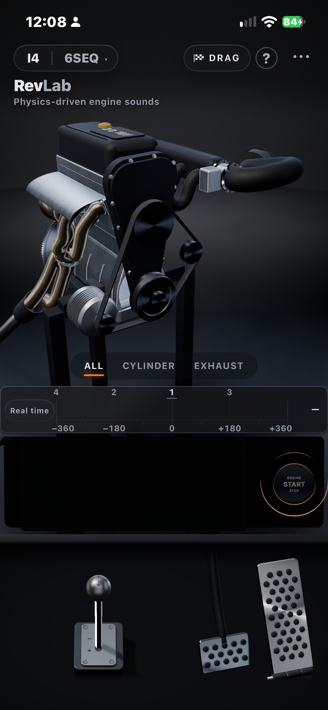
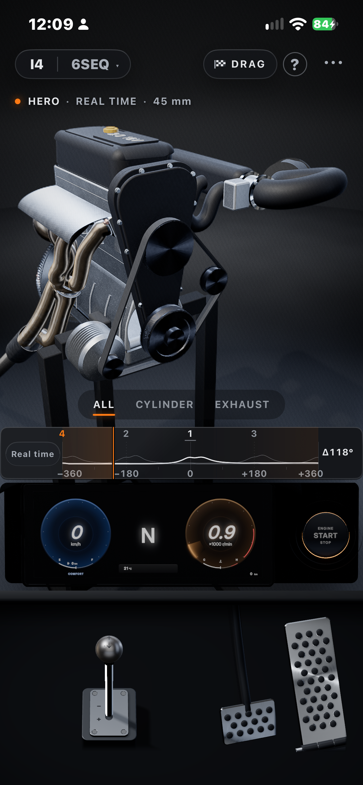
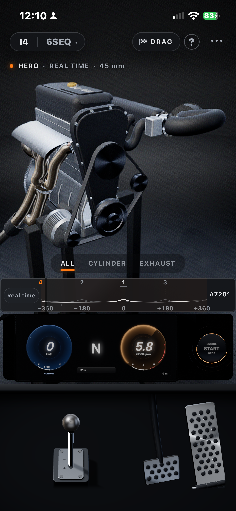
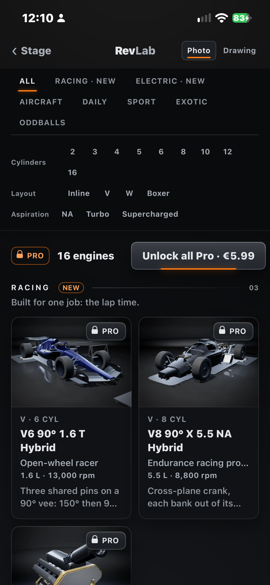
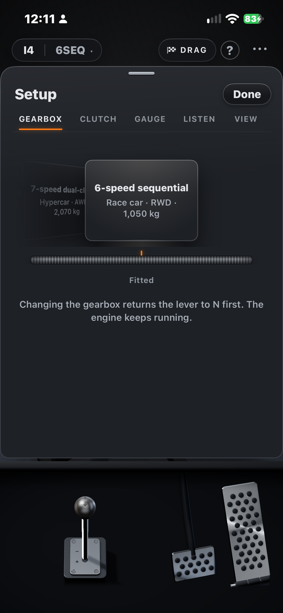
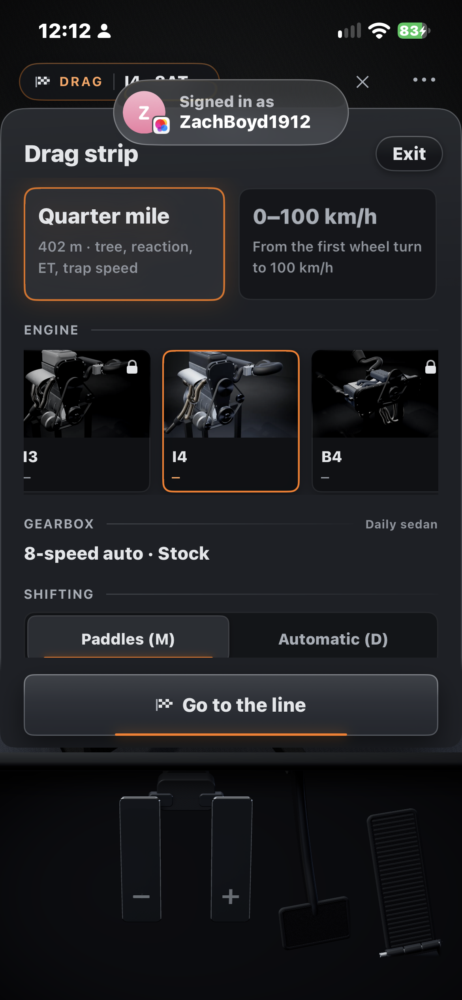

Extra captures kept in the same folder: `revlab-extra-daily.png` (Daily category),
`revlab-extra-gauge.png` (GAUGE tab), `revlab-extra-clutch.png` (CLUTCH tab),
`revlab-extra-listen.png` (LISTEN tab), `revlab-extra-view.png` (VIEW tab),
`revlab-extra-menu.png` (the "…" menu). Accessibility tree: `revlab-tree.json`,
readable dump in `_revlab-tree-labels.txt`; garage tree `_revlab-garage-tree.json`.

### Layout

- **Top bar**: two chips on the left (`I4` | `6SEQ ▾`) and three on the right
  (`DRAG`, `?`, `…`). Each is a 44 pt rounded pill with a hairline border.
- **Wordmark block**: "RevLab" at 24 pt over "Physics-driven engine sounds" at 11 pt,
  both left-aligned at 16 pt margin. When the engine runs, a single uppercase line
  appears under it: `● HERO · REAL TIME · 45 mm` (an amber dot, then camera, timebase
  and a millimetre figure).
- **Hero object**: the 3D engine occupies y≈91–455 (about 43 % of the screen) on a
  near-black ground with a soft top-down pool of light. Exhaust headers are the only
  warm-coloured thing in the frame.
- **Focus segment**: `ALL · CYLINDER · EXHAUST`, 44 pt tall, amber underline on the
  active item, sitting on top of the 3D stage.
- **Cycle strip**: a full-width 56 pt band — `Real time` chip on the left, cylinder
  numbers `4 2 1 3` over the trace, axis `−360 −180 0 +180 +360`, a live `Δ118°`
  readout on the right. When running, an amber wedge fills from 0 to the cursor and a
  white trace is drawn across.
- **Instrument well**: a black panel with a blue speedo (`0 km/h`, `COMFORT`), a
  central gear letter (`N`), an amber tach (`0.9 ×1000 r/min`), a `21°` coolant bar
  and a `0 km` odometer, plus a 72 pt circular `ENGINE START/STOP` knob with an amber
  ring on the right.
- **Control deck** (bottom 175 pt): a 3D gear lever in a `+`/`−` gate, a 3D brake
  pedal, a 3D accelerator pedal. When the gearbox is switched to an automatic, the
  lever is replaced by a `DRIVE MODE` rocker and a physical `P R N D` strip
  (seen in `revlab-extra-menu.png`).
- **Colour**: near-black (#0E0E0F) with one accent — amber (~#F0A03A). Blue appears
  only in the speedo. No gradients on chrome, only on the 3D render.
- **Typography**: tight geometric sans; micro-labels are 10–11 pt uppercase with wide
  tracking; numerals are the only large text.

### Feature inventory

- **21 engines** in the garage (`21 engines` container), grouped
  `ALL · RACING·NEW · ELECTRIC·NEW · AIRCRAFT · DAILY · SPORT · EXOTIC · ODD BALLS`,
  filterable by cylinders (`2 3 4 5 6 8 10 12 16`), layout (`Inline V W Boxer`) and
  aspiration (`NA Turbo Supercharged`).
- Full catalogue read from the garage tree: V6 90° 1.6 T Hybrid, V8 90° X 5.5 NA
  Hybrid, V10 90° NA (19,200 rpm), Electric 4 motors 1,400 kW, high-bypass turbofan
  (120 kN, BPR 5.3), afterburning turbofan (130 kN, BPR 0.6), 9-cylinder radial
  (29.9 L), I3, I4, B4, I6, V8 90° FP, V8 90° X, V10 72°, V12 65°, V16 45°, W16 90° QT,
  two-rotor and four-rotor rotaries, V2 45°, I5 — each with a one-line character note
  ("405° then 315°: the gap between the two beats is the rhythm").
- **Free vs paid**: the paywall bar reads `One purchase: 16 engines` +
  `Unlock all Pro · €5.99`; the I4 NA card is badged **ON STAGE** rather than locked.
- **Setup sheet** with five tabs: GEARBOX (carousel of gearboxes with car class,
  drivetrain and kerb weight), CLUTCH (a four-detent machined dial: `GUARD / LAUNCH /
  OFF / SHIFT`), GAUGE (cluster by era, e.g. `Daily digital · 2020s · 12.3-inch TFT`),
  LISTEN (position: Rear 3 m / Driver seat / Engine bay / Front 3 m / Measurement mic;
  venue `Studio cell`; "Changing it crossfades over 600 ms"), VIEW (cluster lighting
  AUTO/DAY/NIGHT, display level DRIVER/ENGINEER/LAB, units, engine cycle on/off).
- **Drag strip** as a second mode: `Quarter mile` ("402 m · tree, reaction, ET, trap
  speed") or `0–100 km/h`; per-run engine thumbnails; gearbox card; `Paddles (M)` /
  `Automatic (D)`; primary CTA `Go to the line`.
- Pedals respond to a press-and-hold: a long-press on the accelerator took the engine
  from 0.9k to 5.8k rpm and `Δ720°` on the cycle strip (`revlab-03.png`).
- A Game Center "Signed in as …" banner appeared over the drag-strip sheet (system UI).

### What Piston Forge should copy

1. **One accent colour, one hero object.** The whole screen is black, white type and
   amber. Nothing else competes with the render. Piston Forge's five-tab portrait shell
   can afford this discipline.
2. **The cycle strip** — cylinder numbers above the trace, a degree axis from −360 to
   +360, and a live `Δ°` readout. Piston Forge has this at 0 % (firing-order timeline
   strip, `docs/implementation-status.md`).
3. **Microcopy under every non-obvious control.** "Changing the gearbox returns the
   lever to N first. The engine keeps running." One sentence per control, in plain
   English, no tooltips.
4. **Garage cards carry technical identity, not marketing**: eyebrow (`V · 6 CYL`),
   name (`V6 90° 1.6 T Hybrid`), role (`Open-wheel racer`), spec line (`1.6 L ·
   13,000 rpm`), then a character line. Two-up grid, 174 pt wide cards.
5. **The fitted engine is "ON STAGE", not "locked".** The paywall sells 16 engines; the
   one you are driving is presented as what is running, not as a teaser.
6. **A single state line instead of a settings readout**: `● HERO · REAL TIME · 45 mm`
   tells you camera, timebase and one engine parameter in 13 pt.

### What Piston Forge should avoid

1. **Locked badges on most of the 21 cards** (the tree carries 15 individual `Unlock …`
   controls), with the price bar pinned above the list. The screen reads as a store
   before it reads as a garage; there is no per-card price, so the only way to know
   what €5.99 buys is the one number in the bar.
2. **A 210-partner consent CMP** (`RevLab asks for your consent…`, "shared with 210
   partners", inside an `XCUIElementTypeWebView`). It never drew in any of my captures,
   but it is in the tree — a shipping risk and a first-launch tax.
3. **A 43 %-tall static render that carries no information when the engine is off.**
   Before Start, the biggest element on screen is a picture. The dyno cell could show
   belt/crank motion at rest or a "ready" state instead (the tree does carry a
   `Ready to start · 100 %` chip, which was not visible in the capture I took).

---

## 3. Engine Simulator 1.4

`com.simulation.engine-simulator` — **landscape only**; taps could not be injected
(see Method). One capture, plus a full accessibility tree.

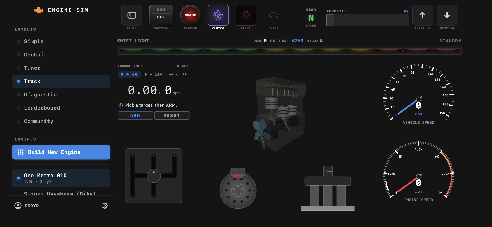

Accessibility tree: `esim-tree.json`, dump `_esim-tree-labels.txt`.

### Layout

- **Left rail, 105 pt**: engine logo + `ENGINE SIM` wordmark; `LAYOUTS` list
  (`Simple, Cockpit, Tuner, Track, Diagnostic, Leaderboard, Community`) with the active
  row as a filled blue-grey pill; `ENGINES` list with a full-width blue
  `Build New Engine` button; account row (`ZBOYD`) and a gear at the bottom.
- **Toolbar** (~43 pt tall buttons, icon over 6 pt label): `PANEL`, `IGNITION` (RUN/OFF),
  `STARTER` (a 36 pt red dome labelled CRANK), `CLUTCH`, `BRAKE`, `CHECK`, then
  `GEAR / 5-SPD`, a horizontal `THROTTLE` bar with a `0%` readout, `SHIFT UP`,
  `SHIFT DN`.
- **Shift-light strip**: `SHIFT LIGHT` left, `RPM 0 · OPTIMAL 6369 · GEAR N` centre,
  `STANDBY` right, over a multi-segment green→yellow→red bar.
- **Main area**: a launch-timer tile on the left (`0 → 60 / 0 → 100 / 60 → 130`
  target chips, a big `0.00 s · 0 mph`, "Pick a target, then ARM.", `ARM` and `RESET`);
  a see-through 3D engine in the middle; an H-pattern 5-speed gate, a clutch disc and a
  pedal bracket along the bottom.
- **Right column**: two large analogue gauges — `VEHICLE SPEED` (0–195 mph) and
  `ENGINE SPEED` (0–9K, red from 7.5K).
- **Colour**: charcoal-blue (#141A24) panels, hairline #2A3340 borders, blue for
  selection, red for starter/redline, a single amber `CHECK` lamp.
- **Typography**: condensed technical sans, 6–8 pt labels, 8 pt uppercase headers.

### Feature inventory (screen + tree)

- 7 layouts; 13 named engines + a custom build:
  `Geo Metro G10 (1.0L · 3 cyl)`, `Suzuki Hayabusa (Bike) 1.3L · 4`, `Honda F20C
  (VTEC) 2.0L · 4`, `Audi 2.2 I5 2.2L · 5`, then locked: `Subaru EJ25 (Equal-Length
  Headers)`, `Subaru EJ25 (Boxer Rumble)`, `BMW M52B28`, `Toyota 2JZ`,
  `Ferrari 412 T2 (F1) 3.0L · 12`, `Ferrari F136 V8 4.5L · 8`, `Lexus LFA V10 4.8L ·
  10`, `GM LS V8 5.7L · 8`, `Chevy 454 Big Block 7.4L · 8`, plus a saved
  `New Engine · 6.7L · 12 cyl · custom` with Edit/Bin controls.
- Launch timer with three targets, ARM/RESET, and `OPTIMAL 6369` as a shift point.
- Community and Leaderboard sections exist as layouts (not opened).

### Copy

1. **`OPTIMAL 6369`** next to RPM and gear — the shift light states the number to shift
   at, not just a colour. Cheap, and it teaches the engine's power band.
2. **Engine rows are two lines: name + `displacement · cylinder count`.** Zero
   decoration, instantly scannable.
3. **The engine is drawn see-through by default** — pistons, rods and crank visible
   inside the block. That is the single most "simulator" thing on any of these screens.
4. **A `CHECK` lamp** in the toolbar as a first-class control (fault codes), not a
   settings toggle.

### Avoid

1. **6–8 pt labels.** On a 6.1" phone in landscape the left rail is a wall of
   unreadable uppercase; `SHIFT UP` and `THROTTLE` are legible only because they are
   isolated.
2. **A desktop layout with no reflow.** Everything is pinned to a 844×390 canvas;
   there is no larger touch target anywhere on the screen.
3. **13 presets, 9 locked, no price and no visible unlock route on this screen.** The
   lock icons are 4.7 pt wide — effectively invisible.

---

## 4. Engine Simulator 3D 1.6.2

`io.groundcode.enginesimulator` — portrait. Two captures.

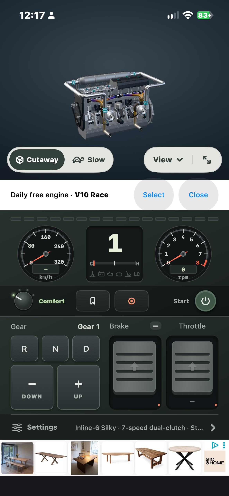
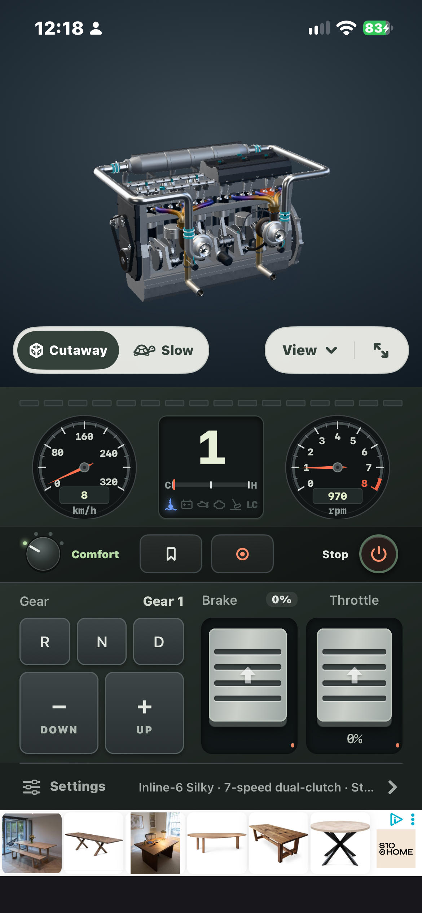

Accessibility tree: `esim3d-tree.json`, dump `_esim3d-tree-labels.txt`.

### Layout

- **3D studio, y = 0–357 pt**: the engine floats in a blue-grey vignette. Three pill
  controls sit at its base — `Cutaway` (dark, selected, cube icon), `Slow` (turtle
  icon) — and on the right `View ▾` + a full-screen glyph. The whole area is a
  "Drag the engine to change the angle" surface.
- **Reward strip, 36 pt** on first launch: white bar, `Daily free engine · V10 Race`,
  `Select` and `Close` buttons.
- **Instruments, y = 357–538**: two circular gauges (~120 pt) (speed 0–320 km/h, tach
  0–8 ×1000 rpm with the 7–8 band red) either side of a 98 pt centre block — a giant
  gear numeral `1`, a `C —— H` coolant bar, and a row of five warning-lamp glyphs.
  A row of small empty rounded rectangles sits above the dials (unlit indicator
  slots).
- **Control row, 44 pt**: a `Comfort` drive-mode dial with six detent dots, a bookmark
  button, a record button (orange), and a `Start` label + 44 pt power button that turns
  into `Stop` with an orange ring when running.
- **Gear and pedals, y = 538–705**: `R N D` on one row, `− DOWN` / `+ UP` on the next;
  then two 89×126 pt pedal targets (`Brake`, `Throttle`) drawn as ribbed pedals with a
  large up-arrow and a `0%` readout.
- **Footer**: a `Settings` row reading `Inline-6 Silky · 7-speed dual-clutch · Stock`;
  then a **61 pt AdMob banner**.
- **Colour**: deep blue-grey ground (#2A3441 → #1A212B), cream pills (#EDEDE6), orange
  accent only on the running-state ring and the record button.
- **Typography**: rounded geometric sans, 11 pt uppercase labels, 52 pt gear numeral.

### Feature inventory

- 13 engines + a custom build (tree): `Geo Metro G10 1.0L · 3`, `Suzuki Hayabusa (Bike)
  1.3L · 4`, `Honda F20C (VTEC) 2.0L · 4`, `Audi 2.2 I5 2.2L · 5`, then locked
  `Subaru EJ25 (Equal-Length Headers)`, `Subaru EJ25 (Boxer Rumble)`, `BMW M52B28`,
  `Toyota 2JZ`, `Ferrari 412 T2 (F1)`, `Ferrari F136 V8`, `Lexus LFA V10`, `GM LS V8`,
  `Chevy 454 Big Block`, plus `New Engine 6.7L · 12 cyl · custom`.
- Idle state is simulated properly: after Start the cluster read **970 rpm and
  8 km/h in gear 1**, i.e. the car creeps.
- Cutaway / Slow-motion / View (camera) / full-screen; drive mode; bookmark; Record;
  My setup (a preset slot); daily free engine.
- No power/torque graph and no tuning screen were reachable (see limits).

### Copy

1. **`Cutaway`** as a one-tap toggle: the same model becomes a teaching diagram. Piston
   Forge has X-ray at 0 %.
2. **Gear as a 52 pt numeral in the middle of the cluster**, with the coolant bar and
   warning lamps directly under it. You can read the car's state from arm's length.
3. **Pedals as 89×126 pt vertical targets** with an up-arrow and a live `0%`. No
   precision required, one thumb.
4. **A single configuration line at the bottom** (`Inline-6 Silky · 7-speed
   dual-clutch · Stock`) that doubles as the way into Settings.

### Avoid

1. **The banner ad directly under the controls.** One tap intended for the engine
   studio opened an advertiser page (`s10home.ie`). Whatever the mechanism, an ad
   strip 61 pt from a `Settings` row is unacceptable in a driving sim.
2. **A first-launch reward strip between the 3D view and the gauges.** It pushes the
   cluster down by 52 pt and asks for a decision (`Select` / `Close`) before the user
   has heard the engine.
3. **`Select` / `Close` as two equal 68×58 pt grey pills** — the primary action and the
   dismissal are visually identical.

---

## 5. Tuning Simulator 1.2.3

`com.scottbusby.tunelab` — **landscape only**; taps could not be injected. One capture,
plus a full accessibility tree that exposes the whole left column.

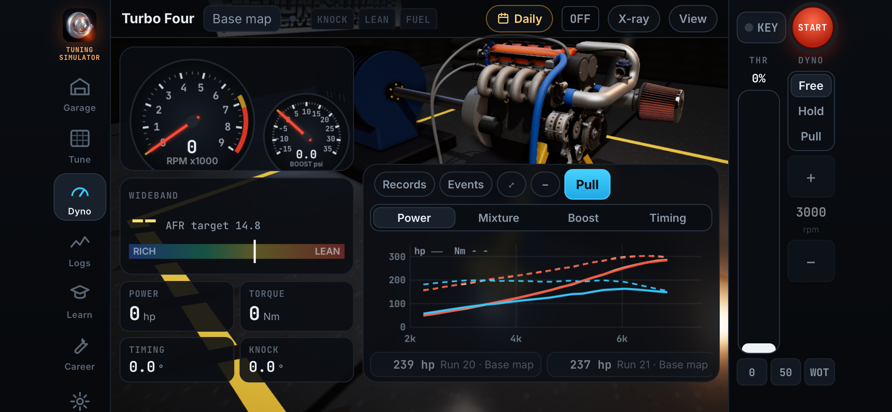

Accessibility tree: `tunelab-tree.json`, dump `_tunelab-tree-labels.txt`.

### Layout

- **Left rail, 105 pt**: app icon + `TUNING SIMULATOR`; `Garage, Tune, Dyno, Logs,
  Learn, Career, Setup`; the active item (`Dyno`) is a filled tile with a cyan gauge
  glyph; a theme toggle at the bottom.
- **App bar**: car name `Turbo Four`, a `Base map` chip, then a row of flags
  `KNOCK · LEAN · FUEL · BOOST`, then `📅 Daily` (gold outline), `OFF`, `X-ray`,
  `View`.
- **Left column (220 pt)**: two circular gauges at the top (`RPM ×1000` 0–9 with a red
  7–9 band, `BOOST psi` −15…35); below them a `WIDEBAND` panel with `AFR target 14.8`
  over a `RICH → LEAN` gradient bar and a white slider handle; then a two-column
  readout grid that continues off-screen in the capture.
- **Dyno panel (right, ~335 pt of the 584 pt main area)**: a tab row `Records ·
  Events · ↙ · − · Pull` (`Pull` is the filled cyan primary), a sub-tab row `Power ·
  Mixture · Boost · Timing`, then a chart: y 0–300, x 2k/4k/6k rpm, legend `hp — Nm
  - -`, two dashed reference curves (red = hp, cyan = Nm) and two solid current
  curves. Under the chart, horizontal run cards: `239 hp Run 20 · Base map`,
  `237 hp Run 21 · Base map`, …
- **Right rail, 155 pt**: `KEY` (grey, disabled) and `START` (red 42 pt dome), `THR
  0%`, `DYNO` with `Free / Hold / Pull` stacked, `+` / `3000 rpm` / `−`, and a vertical
  slider with a white knob; at the bottom `0 · 50 · WOT` shortcuts.
- **Colour**: near-black panels, cyan as the only interactive accent, gold reserved for
  the daily offer, red for the starter and the redline.
- **Typography**: 13 pt uppercase labels with 1 pt letter-spacing, 26 pt numerals —
  monospaced-feeling, instrument-panel density.

### Feature inventory (screen + tree)

- 7 sections; a live sensor grid of 13 channels: `WIDEBAND, POWER, TORQUE, TIMING,
  KNOCK, EGT, IAT, COOLANT, FUEL (psi, "sensor"), INJ DUTY, OIL (psi + oil temp),
  TANK (E0 · 25 L · 41 °C), HEALTH (100 %, "tap for detail")`.
- At least **10 recorded dyno runs** persisted for the current car (`Run 20`…`Run 29`,
  239, 237, 283, 282, 291, 288, 285, 288, 285, 163 hp), all tagged `Base map` — a bad
  tune (163 hp) sits in the same list as good ones.
- Four chart views (Power, Mixture, Boost, Timing), a Records list, an Events list,
  Expand/Hide for the panel, and three dyno modes (Free/Hold/Pull) with a target rpm.
- `0 / 50 / WOT` throttle shortcuts; `X-ray`; `View`; per-car `Base map`.

### Copy

1. **The always-on sensor grid.** Thirteen channels visible while you tune, no modal,
   no scroll. This is what "dense cockpit" means and it is exactly what Piston Forge's
   Tune screen (35 %) is missing.
2. **Run history as cards under the chart**, each showing `power + run number + map
   name`, overlaid as dashed reference curves.
3. **Dyno modes as a three-way state** (`Free / Hold / Pull`) with a numeric target
   (`3000 rpm`) and `0 / 50 / WOT` shortcuts. Piston Forge's Dyno is missing Hold and
   Pull modes.
4. **A legend that encodes line style** (`hp — Nm - -`): solid = this run, dashed =
   reference. No colour-only encoding.
5. **Cyan for "interactive", red for "danger", gold for "daily"** — three meanings,
   three colours, used consistently.

### Avoid

1. **13 pt labels in a 105 pt rail** — at 6.1" the rail text is at the edge of
   legibility, and the rail eats 27 % of the width before any data.
2. **`KNOCK · LEAN · FUEL · BOOST` as plain text in the app bar.** They sit where
   buttons live and read as buttons, but they are a status list.
3. **No visible monetisation on the tuning screen** — no price, no store, no indication
   of what is free. (Not a fault, but it means the value proposition has to be inferred
   from the UI alone.)

---

## 6. Drag Race Sim 1.3.2 *(optional, limited)*

`com.jerrycrews.DragRaceSim` — **landscape only**; taps could not be injected. One
capture.

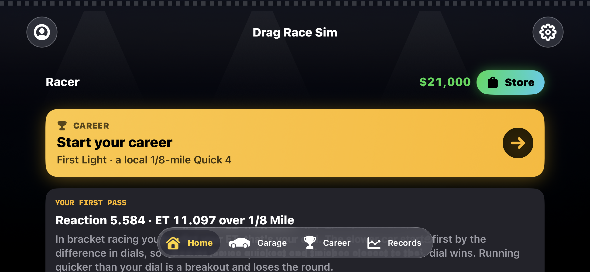

### Layout

- Full-bleed dark 3D scene (a start line under three light cones), a checkered strip
  along the very top edge.
- Header: circular profile avatar (left), `Drag Race Sim` centred, gear (settings) right.
- A second row: `Racer` (player name) left; `$21,000` in green and a `Store` pill with a
  teal→green gradient and a bag icon, right.
- **One gold career card**: trophy glyph + `CAREER`, `Start your career`, `First Light ·
  a local 1/8-mile Quick 4`, and a circular arrow button on the right.
- **A dark "YOUR FIRST PASS" card**: `Reaction 5.584 · ET 11.097 over 1/8 Mile`, then a
  paragraph explaining bracket racing and breakouts.
- Floating bottom tab bar: `Home` (gold icon + gold label), `Garage`, `Career`,
  `Records`.

### Copy

1. **One primary card, one action.** Gold card, one sentence of context, one arrow.
2. **Teaching copy inside the home screen** — the bracket-racing rule ("running
   quicker than your dial is a breakout and loses the round") is explained where the
   player will meet it, not in a tutorial modal.
3. **The results line reads like a time slip** (`Reaction 5.584 · ET 11.097 over
   1/8 Mile`) — units and ordering a racer already knows.

### Avoid

1. **Body text runs under the floating tab bar** — the paragraph is visibly clipped by
   the Home/Garage/Career/Records bar.
2. **No indication of progression** on the card beyond the name `First Light`; the
   player cannot see how many rounds or what unlocks next.

---

## 7. Car Dealer Sim 0.3.1 *(optional, limited)*

`com.FizzStarLab.CarFlipper` — portrait. Three captures.

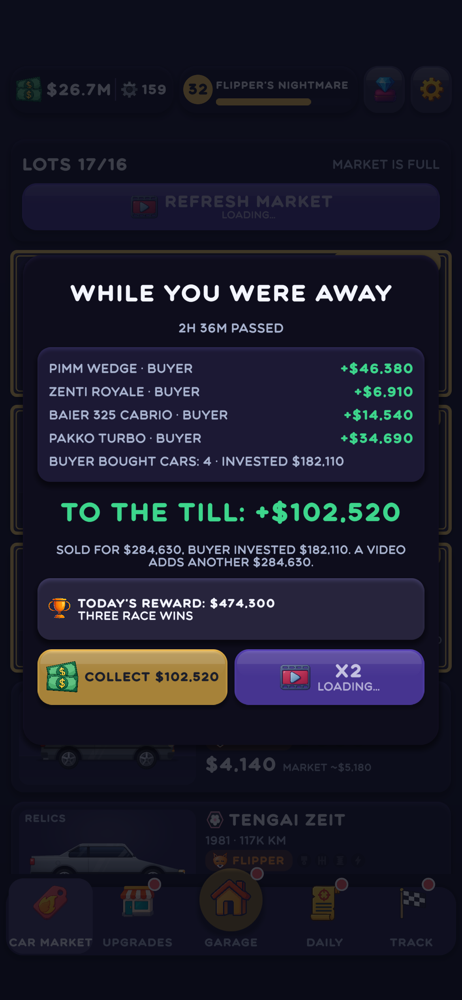
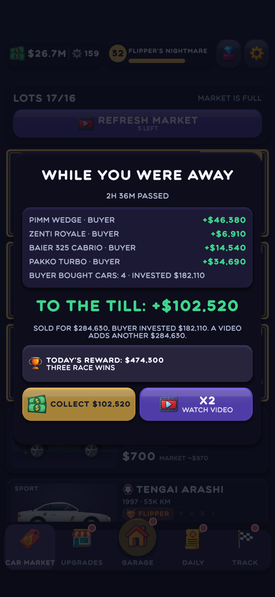
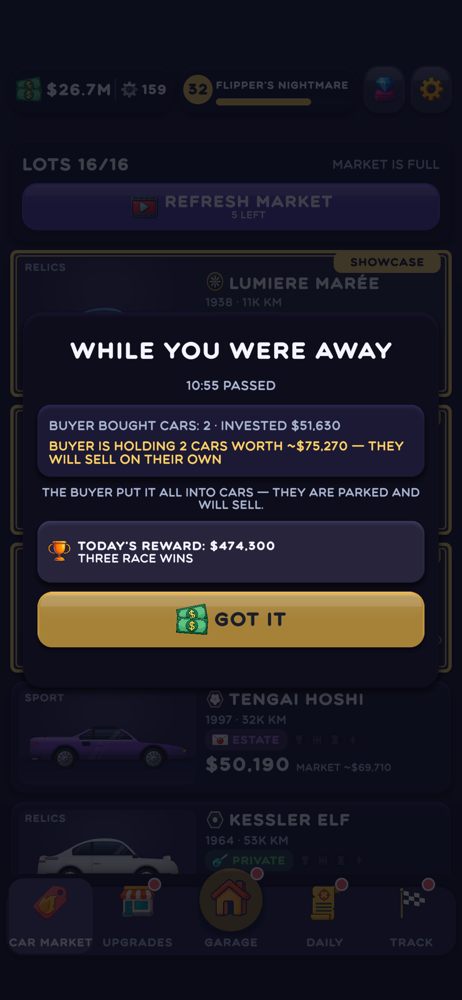

Accessibility tree: `cardealer-tree.json` — 688 bytes, i.e. **the application node and
nothing else**, while the screen visibly carries ~40 labelled controls. Nothing in this
app is exposed to VoiceOver or to automation.

### Layout

- **Header, ~130 pt**: `$26.7M` cash, `⚙ 159` level, a circular season badge `32` with
  the season name `FLIPPER'S NIGHTMARE` and a progress bar; two square buttons
  (one showing stacked items, one a gear).
- **Market block**: `LOTS 17/16` (over capacity) and `MARKET IS FULL`; a full-width
  `▶ REFRESH MARKET` button with a counter (`LOADING…` → `5 LEFT`).
- **Modal**: `WHILE YOU WERE AWAY` / `2H 36M PASSED`; an itemised receipt (four cars
  with `+$46,380`, `+$6,910`, `+$14,540`, `+$34,690`, then `BUYER BOUGHT CARS: 4 ·
  INVESTED $182,110`); `TO THE TILL: +$102,520` in green; an explainer ("A VIDEO ADDS
  ANOTHER $284,630"); a `TODAY'S REWARD: $474,300 THREE RACE WINS` row; two buttons —
  gold `COLLECT $102.520` and purple `▶ ×2 WATCH VIDEO`.
- **Background (dimmed)**: a market list with a car silhouette, an asking price and a
  `MARKET ~$5.180` reference per row.
- **Bottom nav, 5 tabs**: `CAR MARKET · UPGRADES · GARAGE · DAILY · TRACK`, with red
  badge dots.
- **Typography**: condensed all-caps, chunky; colour is doing the work (green = money,
  gold = reward, purple = ad, red = badge).

### Copy

1. **"While you were away" as a receipt**, not a number: per-car lines, then invested
   vs sold. Offline progress is legible in one screen.
2. **A reference price on every market row** (`MARKET ~$5.180`) next to the asking
   price (`$4.140`) — the profit is implicit, no maths.

### Avoid

1. **Two equal-weight buttons where one is a rewarded ad** (`COLLECT` gold vs `×2
   WATCH VIDEO` purple) and the modal is first-launch (`cardealer-01.png`). The screen
   asks for an ad before the user has played. The next launch produced a different,
   honest variant with one `GOT IT` button (`cardealer-03.png`) — so the ad button is a
   rotating variant, not a fixture.
2. **The modal did not dismiss** on two taps of `COLLECT`, 3 s and 8 s apart, while the
   dimmed list behind it kept rotating cars — either the hit area is wrong or the
   button is gated on ad-SDK initialisation. *(uncertain: two attempts only)*
3. **Zero accessibility.** The tree is one node. Every price, car name and tab is a
   picture as far as VoiceOver is concerned.
4. **Four competing progress indicators in the top 130 pt** (cash, level, season tier,
   season progress) plus two badge counters.

---

## 8. Gaps this exposes in Piston Forge

Checked against `docs/implementation-status.md` (18/11/2026). Each line is checkable.

1. **Firing-order / cycle strip — Piston Forge 0 %, RevLab ships it.**
   RevLab draws a −360…+360° strip with cylinder numbers (`4 2 1 3`) above the trace,
   an amber wedge for the current cycle and a live `Δ°` readout. Piston Forge's Engine
   tab has no equivalent.
2. **Listening positions — Piston Forge 0 %, RevLab has five.**
   RevLab's LISTEN tab offers Rear 3 m / Driver seat / Engine bay / Front 3 m /
   Measurement mic, with venue `Studio cell` and a stated 600 ms crossfade. Piston Forge
   has "listening positions (bay, cabin)" at 0 %.
3. **X-ray / cutaway — Piston Forge 0 %, two competitors have it.**
   ES3D's `Cutaway` is a one-tap toggle on the hero model; TuneLab has an `X-ray`
   control in its app bar. Piston Forge lists "X-ray cutaway with combustion glow" at
   0 %.
4. **Dyno modes with a target — Piston Forge missing, TuneLab has them.**
   TuneLab's right rail offers `Free / Hold / Pull` plus `+/− 3000 rpm` and `0 / 50 /
   WOT`. Piston Forge's Dyno (50 %) is "live pull with traces and last-pull overlay;
   missing Hold and Pull modes".
5. **Run history as tappable reference cards — Piston Forge missing ("logs tab").**
   TuneLab keeps ≥10 runs per car (`239 hp Run 20 · Base map`) and overlays earlier
   runs as dashed curves in the same chart. Piston Forge has a last-pull overlay only.
6. **An always-on sensor grid — Piston Forge's Tune screen is 35 %.**
   Thirteen live channels (WIDEBAND, POWER, TORQUE, TIMING, KNOCK, EGT, IAT, COOLANT,
   FUEL, INJ DUTY, OIL, TANK, HEALTH) stay on screen during tuning in TuneLab. Piston
   Forge's Tune screen has tables and an auto base map but no persistent readout grid.
7. **Garage cards / compare — Piston Forge "compare screen and cards not built".**
   RevLab's card = render + `V · 6 CYL` eyebrow + name + role + `1.6 L · 13,000 rpm` +
   one character line, in a two-up grid, with an `ON STAGE` badge on the fitted engine.
8. **A gearbox/clutch setup sheet with per-option specs — Piston Forge gearboxes 40 %.**
   RevLab stacks a card carousel (gearbox name, car class, drivetrain, kerb weight), a
   four-detent clutch-mode dial (`GUARD / LAUNCH / OFF / SHIFT`) and one explanatory
   sentence per tab. Nothing like this exists in Piston Forge.
9. **Drag strip with a tree, reaction time and trap speed — Piston Forge 30 %.**
   Piston Forge's strip has "timeslip (60 ft to a mile), no 3D strip, no Christmas
   tree, no reaction time"; RevLab's drag sheet advertises exactly `tree, reaction, ET,
   trap speed` and Drag Race Sim's home card shows `Reaction 5.584 · ET 11.097`.
10. **A shift-point readout — not present in Piston Forge's status list.**
    Engine Simulator shows `OPTIMAL 6369` beside `RPM` and `GEAR`; Piston Forge's drive
    screens show rpm but no stated shift target.
11. **A landscape cockpit — Piston Forge's landscape layout is 10 %.**
    Three of the six competitors are landscape-first (Engine Simulator, Tuning
    Simulator, Drag Race Sim). Whatever else is true, part of the category ships a wide
    instrument panel rather than a stretched portrait screen.
12. **Units / display-level settings surfaced in the run screen — Piston Forge settings
    60 %, "several settings are not used yet".**
    RevLab's VIEW tab exposes `AUTO/DAY/NIGHT` cluster lighting, `DRIVER / ENGINEER /
    LAB` display level, units, and an engine-cycle switch, with a paragraph explaining
    each. It makes the settings feel like part of the sim.
13. **Free-tier framing — Piston Forge has no store.**
    RevLab marks the fitted engine `ON STAGE` and sells the rest with one price
    (`€5.99`, 16 engines). If Piston Forge ever monetises, that is the pattern to copy;
    if it does not, the lesson is the inverse — never let lock badges outnumber
    "running" badges on the garage screen.
14. **Ad placement — Piston Forge has no ads; keep it that way.**
    ES3D's 61 pt banner sat 44 pt under the `Settings` row and a tap intended for the
    engine opened an advertiser page. Car Dealer Sim opens on a modal that asks for a
    rewarded video.

---

## 9. Method and limits

**How the phone was driven**

- `ios` (go-ios 1.3.2) over USB with the userspace tunnel, against
  iPhone 13 `00008110-001A2D200CDB801E`, iOS 27.2. DeviceKit runner 0.0.18 was already
  running (`ios ui status` → `OK`).
- `ios launch <bundle>` to open, `ios screenshot --output=<path>` to capture,
  `ios ui tap --x --y` to tap, `ios ui longpress` to hold (used for the throttle blip in
  `revlab-03.png`), `ios ui button home` to leave.
- `ios ui source --output=<path>` for the accessibility tree; `_*-tree-labels.txt` are
  flat dumps (type | label | value | rect) produced from those JSON files with
  `builds/tmp/walk-tree.ps1` (gitignored helper, kept for re-runs).
- Screenshots come back at 390×844 pt for portrait apps and 2000×920 px (≈844×390 pt)
  for landscape apps; all tap coordinates were computed as `px × 0.423`.

**What could not be reached, and why**

- **Every landscape app rejected the injected taps.** Engine Simulator, Tuning
  Simulator and Drag Race Sim are landscape-only, and none of them changed state after
  any tap: 9 attempts on Engine Simulator (portrait space, landscape space, and both
  180°-mirrored mappings), 6 on Tuning Simulator, 1 on Drag Race Sim. The runner reports
  `orientation: LANDSCAPE` but `screenSize: 390×844` (portrait), which is the likely
  cause; `ios ui orientation set PORTRAIT/LANDSCAPE` did not change it. So for those
  three apps **only the launch screen is documented**, and every other claim about them
  comes from the accessibility tree (which does expose the whole left column, engine
  lists and run history).
- **Engine Simulator 3D's lower controls.** `Close` and `Start` worked; `Settings`
  (4 attempts, 3 launches), `My setup` and `View` did nothing. One tap in the engine
  studio opened an advertiser page (`s10home.ie`), which I closed with the home button
  without interacting with it. Whether the ad's hit area covers the app or the app has
  a blocked main thread is **uncertain**. No tuning, engine-list or graph screen was
  reachable, so ES3D's feature inventory stops at what is on the main screen plus its
  tree.
- **Car Dealer Sim's modal** would not dismiss on two taps of `COLLECT`; everything
  behind it stayed dimmed. A relaunch showed a different, single-button `GOT IT` variant
  of the same modal. Only the home/market screen (behind and in front of that modal) is
  documented.
- **Car Dealer Sim exposes no accessibility elements.** `cardealer-tree.json` is a
  single application node. Taps still reached the app, so this is a labelling problem,
  not a rendering one — but it means the screen cannot be verified by label, only by
  screenshot.
- **Paid and gated screens were not entered**: RevLab Pro engines (€5.99), ES3D's
  locked engines, Engine Simulator's 9 locked presets, Tuning Simulator's Tune / Garage
  / Logs / Learn / Career / Setup, Drag Race Sim's Store / Garage / Career / Records.
- **No ratings, star counts or App Store prices are quoted** — none were visible
  anywhere in the apps, and I did not look at the App Store.
- **Permissions, sign-ins, purchases**: none were triggered. RevLab and ES3D carry a
  Google-Funding-Choices-style consent page ("shared with 210 partners") inside a
  WebView; it was present in both accessibility trees but never drew in any capture, so
  I did not consent to or reject anything. Game Center was already signed in, and its
  "Signed in as …" banner appeared twice as system UI.
- Two system notification banners (a GitHub workflow notice, an Adverts.ie offer) and
  one Snapchat banner crossed captures; the affected frames were retaken where possible.
  `revlab-extra-clutch.png` was retaken after one such banner.

**Uncertain claims, flagged**

- Whether Engine Simulator's locked presets can be unlocked without a purchase — never
  reached.
- Whether ES3D's Settings failure is an ad hit-area problem or an app freeze — the
  cluster stopped updating (800 rpm froze for ~60 s) before the ad page opened, so both
  are possible.
- Whether Car Dealer Sim's `COLLECT` is broken or waiting on ad-SDK initialisation —
  two attempts only.
- The meaning of RevLab's `45 mm` in the state line (a millimetre figure next to camera
  and timebase); it is not labelled anywhere I could reach.
